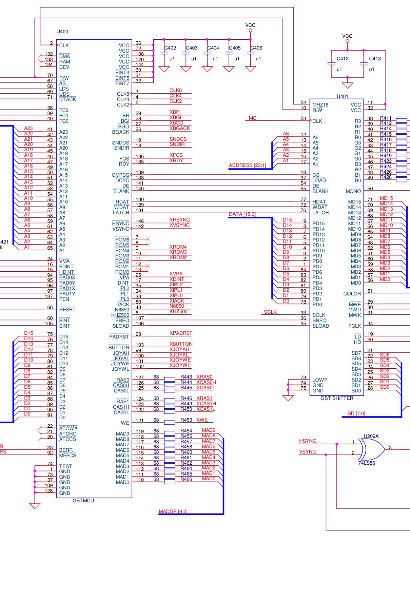

# 2.2 — The chips

What is actually on a 1040STE board, what each part does, and which chapter takes it apart.

> **In one page.** A 1040STE is two Atari customs and a bus, with standard parts hanging off it. The **GSTMCU**
> (`U400`) is the machine's whole nervous system: address decode, chip selects, the RAM's row and column strobes
> and refresh, bus arbitration, video timing, the joystick/paddle/pen ADC, and the blitter's control logic. The
> **GST Shifter** (`U401`) turns bitplanes into pixels: it shifts the display words out, holds the 16-entry palette,
> and drives `DE`, `BLANK` and the three colour buses. Around them sit the standard parts that do one job each — a
> 68000 at 8 MHz, TOS in two 27C010s, one megabyte of DRAM in four SIMM sockets (two populated), a WD1772 floppy
> controller, a DMA controller that can take the bus, an MFP whose timers and interrupt controller the whole system
> runs on, a YM2149 for sound and for two 8-bit ports, two 6850 ACIAs of which one is the keyboard link and one is
> MIDI, and the LMC1992 plus two DACs that make the STE stereo. One board variation matters more than the rest:
> early boards carry a discrete blitter at `U101`, later ones fold that function into the GSTMCU and the socket
> disappears.

## 1. How to read this board, and why the reading needs a caveat

Everything below is read from one document: the **STE Field Service Manual** (Atari P/N C302481-001 Rev A, August
1991), which covers assembly `CA400329-101` and the production parts list. That choice is not arbitrary — it is the
last manual Atari published for this board, and of the two documents that describe it, only this one carries the
production part numbers (`C398739-001` for the DMA, `C300589-001` for the GSTMCU); the 1989 bill of materials has no
GSTMCU row at all.

It needs a caveat that a reader should carry through this whole part. **The file is not a photographic scan of
Atari's printing**: its schematic sheets were redrawn in a CAD tool in 2017 and its parts list retyped, which is
exactly why it is machine-readable — and exactly why it can carry transcription errors of its own. The drawing
number, the reference designators and the pin numbers agree with the 1989 factory drawing wherever both are legible,
and every claim that matters was cross-checked against it; where only the redraw says something, this book says so.

> **Deep dive — what "verified" means here.** A pin is `read` when both documents show it, or when the redraw shows
> it and the pin's function is confirmed by a part number, a datasheet or a net on another sheet. A pin that only
> the redraw shows, with nothing to corroborate it, is `read (redraw only)` and is flagged in the appendix's pin
> tables. The distinction is recorded per row in `design/board-inventory.md`, not averaged away.

*Sources: `design/board-inventory.md` §1.1–§1.5 (the chosen document, the cross-check, what was rejected, how pins
were read); `atari-st-hardware/docs/downloads/ste_fsm_1991.pdf`.*

## 2. The two customs

`U400` and `U401` are the parts that make an STE an STE. Both are Atari-designed and both are large: the GSTMCU is a
144-pin package, the Shifter an 84-pin PLCC.

| ref | part | package | what it owns |
|---|---|---|---|
| **U400** | `C300589-001` IC STE MCU GLUE | 144-pin PGA/PLCC | glue (decode, chip selects), MMU (RAM address muxing, `RAS`/`CAS`, refresh), DMA arbitration, video timing (`DE`, `BLANK`), the joystick/paddle/pen ADC, and the blitter's control |
| **U401** | `C300588-001` IC STESHFTR | 84-pin PLCC | bitplane shift and serialisation, the palette, `DE`/`BLANK` output, and the Microwire controller that drives the LMC1992 |

*The two customs on sheet 4, `Atari STe MCU, SHIFTER and VIDEO`, cropped by `book/tools/crop-schematic.py` from
`ste_fsm_1991.pdf` p67 at 300 dpi. Read the pin names rather than the wires: `U400` carries `A1–A23`, `D0–D15`,
`MAD0–MAD9` and the `RAS`/`CAS` strobes; `U401` carries the `MD`/`SD` buses, the `R`/`G`/`B` nibbles, `MONO`, `DE`,
`BLANK`, and the Microwire trio `MWE`/`MWD`/`MWK`.*

Two properties of this pair decide much of Part 3 and Part 4. First, **the Shifter is a client of the GSTMCU**: it
takes its clock in on pin 33 (`SCLK`) and pin 53, gives `FCLK` out on pin 34 for the sound filters, and does not fetch
its own data — it asks for a display slot on `SREQ`, and the GSTMCU fetches from the DRAM it addresses on
`MAD0–MAD9` and hands the words over on `MD0–MD15`, latched on `SLOAD`. Second, **the GSTMCU is where the board's
timing references are made**: the PSG's 2 MHz `CLK2` and the 500 kHz `KHZ500` that both ACIAs and the floppy's timing
use come out of it, not from separate oscillators.

*Sources: `design/board-inventory.md` §2.1 (customs and their jobs), §3.4 and §3.5 (the pin lists), §4.1 and §4.2
(the clock and `MD`/`MAD` nets); `ste_fsm_1991.pdf` p67 for the figure.*

## 3. The other Atari parts

These are Atari part numbers too — custom or programmed for this machine — but each does one job.

| ref | part | package | job | clock |
|---|---|---|---|---|
| **U300** | `C398739-001` DMA controller | 40-pin DIP | takes the bus (`BR`/`BG`/`BGACK`), runs disk and sound DMA, and speaks ACSI | 8 MHz, the shared `CLK` |
| **U101** | `C101643` ST Blitter | 68-pin PLCC | a second bus master, for block copies | 8 MHz |
| **U203** | `C025984` MFP 68901 | 48-pin DIP | four timers, a USART, the interrupt controller, 8 bits of GPIO | `CLK4` at 4 MHz; `Y200` at 2.4576 MHz for the timers |
| **U202** | `C025983` YM2149 | 40-pin DIP | 3 tone channels, noise, envelope, and two 8-bit I/O ports | 2 MHz, the GSTMCU's `CLK2` |
| **U201** | `C025985` 6850 ACIA | 24-pin DIP | the **keyboard/IKBD link** | 500 kHz `KHZ500`, divided by 64 → 7 812.5 baud |
| **U200** | `C025985` 6850 ACIA | 24-pin DIP | **MIDI** | 500 kHz, divided by 16 → 31 250 baud |
| **U208** | `C025988` PC900 | 6-pin DIP | MIDI input opto-isolator | — |

Three of those rows are corrections, not transcriptions, and they are worth knowing because the parts list gets them
wrong. **The two ACIAs are labelled "MIDI" and "RS-232" in the manual; neither label is right** — RS-232 is the MFP's
USART, and the pair are the keyboard link and MIDI. Which reference is which was settled by Atari's own diagnostic:
the keyboard test asks for 500 kHz on `U201` pin 3, and pin 3 of a 6850 is `RXC`. **The YM2149 is not clocked from the
2.4576 MHz crystal** that sits near it: that crystal is the MFP's timer clock, and the PSG takes the GSTMCU's `CLK2`
at 2 MHz.

*Sources: `design/board-inventory.md` §2.1 (the rows, with their corrections), §2.3 (the oscillators), §3.8–§3.10
(the MFP, PSG and ACIA pin lists), §4.1 (`KHZ500`, `CLK`); `research/standard-parts-implementation.md` §6.1 and
§9.1 (the PSG clock); `research/ikbd-implementation.md` §3 (the divisor and the frame format).*

## 4. The standard parts

The rest of the board is bought-in silicon, and there is less of it than a reader expects.

| ref | part | package | job |
|---|---|---|---|
| **U100** | `C398061-001` MC68000 | 68-pin PLCC | the CPU, 16-bit data / 24-bit address, 8 MHz |
| **U102**, **U103** | `C301163-002`, `C301164-002` | 32-pin DIP | TOS 1.62, high and low halves — two 27C010s |
| **U301** | `C026028-002` WD1772 | 28-pin DIP | floppy disk controller, on `SCLK` (8 MHz) |
| **U508** | `C398058-001` LMC1992 | 28-pin DIP | stereo volume, bass and treble, and the mixer, driven over Microwire by the Shifter |
| **U502**, **U503** | `C398057-001` DAC0802 | 16-pin DIP | two 8-bit DACs, left and right — the STE's stereo sound |
| **U403** | `C101001-117` MC1377 | 20-pin DIP | RGB → composite (modulator and Peritel path) |
| **U405** | 74S257 / 74F257 | 16-pin DIP | RGB or mono select, into the encoder |
| **U104** | `C019748` 555 | 8-pin DIP | reset and power-on delay |
| **U600–U603** | `C398063-001` / `C398152-001` | 30-pin SIMM sockets | the DRAM: 16 × 256K×1 per bank, two banks populated in a 1040 |
| **U303** | `C398066-001` | 8.010613 MHz oscillator | the 8 MHz clock everything digital runs on |
| **U402** | `C398068-001` / `C398097-001` | 32.215905 MHz / 32.084988 MHz | master clock, NTSC or PAL — one fitted, never both |

The 8 MHz net is worth following once, because it explains a family of timing coincidences later: **one oscillator
(`U303`) drives the CPU, the GSTMCU, the DMA controller and the Shifter** — on `CLK` and, for the Shifter, also on
`SCLK` — and the same oscillator's net reaches the floppy controller, which is why the CPU, the bus, the display fetch
and the disk are the same clock divided differently rather than merely synchronous. The FDC's 8.010613 MHz is 0.13 % above the WD1772's datasheet window, which MFM's
self-clocking absorbs.

*Sources: `design/board-inventory.md` §2.2 (the standard-parts rows), §2.3 (oscillators and the SIMM population),
§4.1 and §4.5 (the `CLK`/`SCLK` nets and the FDC's clock); `research/standard-parts-implementation.md` §4.2 (the
0.13 % excursion).*

## 5. What is *not* on the board, though people expect it

Four absences cause most of the confusion about this machine, and all four are documented rather than inferred.

**The blitter is not always a separate chip.** The parts list and sheet 1 of the 1991 manual show a discrete blitter
at `U101`; later `CA4003290` boards drop the package and fold the function into the GSTMCU. This book describes the
**with-blitter** population, because that is the board the manual documents — and says so wherever the difference
matters, because it changes exactly one package and its artefact nets, not the GSTMCU's pinout.

**There is no "Super Hi-Res" mode.** The 1991 parts list carries a row labelled as such at `U401`; no such mode
exists on this board, and the row is the GST Shifter under a label it does not earn. A reader who finds "Super Hi-Res"
elsewhere should know it is not a feature of the machine they have.

**The RAM is not soldered and not fixed.** The PCB has four SIMM sockets; a 520STE populates one bank (two sockets)
and a 1040STE two. Which sockets are filled is a *configuration*, not a board revision — so "1 MB" is a property of
the machine you have, not of the drawing.

**The 1989 BOM does not have a GSTMCU at all.** The pre-production bill of materials runs to its `-- END --` with no
144-pin part, lists a "60 PIN" blitter (a 68-pin socket, so the 1989 list is wrong on the count), and puts the 555
timer at `U106` where the 1991 list has `U104`. A reconstruction from the 1989 document alone would conclude the STE
has no GSTMCU — which is why the 1991 manual is this book's primary source and the 1989 drawing only its
cross-check.

*Sources: `design/board-inventory.md` §6 items 5, 7, 8 and 10 (designator disagreements, the missing GSTMCU, the
blitter population, the RAM configuration), §1.2 (the 1989 BOM and its limits), §2.1 (the "Super Hi-Res" correction
and `research/ste-super-hires.md`).*

## 6. Where each part is taken apart

This chapter is the map; the chapters that follow are the territory.

| part | its chapter |
|---|---|
| GSTMCU, Shifter, palette, `DE`/`BLANK` | 2.5 video |
| YM2149, LMC1992, the DACs, DMA sound | 2.6 sound |
| DMA controller, WD1772, ACSI | 2.7 disk |
| MFP, ACIAs, IKBD, joystick and paddle ports | 2.8 controllers, 2.9 interrupts |
| 68000 | Part 5, in full |
| RAM, `RAS`/`CAS`, refresh, the SIMM sockets | 2.4 memory map, 3.4 refresh and DMA |
| every pin, with its direction and active level | appendix A |

*Sources: the chapter map in `docs/handoffs/documentation-phase.md` §3; `design/board-inventory.md` §5 (the
subsystem grouping that assigns each part to one owner).*

## Where this comes from

1. `design/board-inventory.md` §1.1–§1.5 — the chosen document, its provenance caveat, the 1989 cross-check, what
   was rejected and why, and what "verified" means per pin.
2. `design/board-inventory.md` §2.1 — the Atari customs and programmed parts, with their jobs and their corrections.
3. `design/board-inventory.md` §2.2 — the standard parts, packages and part numbers.
4. `design/board-inventory.md` §2.3 — the oscillators, the crystal, the SIMM population and the DRAM per bank.
5. `design/board-inventory.md` §3.4, §3.5, §3.8–§3.10 — the pin lists of the GSTMCU, the Shifter, the MFP, the PSG
   and the ACIAs, which are where the clock and bus claims come from.
6. `design/board-inventory.md` §4.1, §4.2, §4.5 — the `CLK`, `SCLK`, `KHZ500`, `MD`/`MAD` and disk nets.
7. `design/board-inventory.md` §6 — the open questions, four of which are this chapter's section 5.
8. `atari-st-hardware/docs/downloads/ste_fsm_1991.pdf` p67 — sheet 4, the figure's source, cropped reproducibly by
   `book/tools/crop-schematic.py`.
9. `research/standard-parts-implementation.md` §4.2, §6.1, §9.1 — the FDC's clock excursion, and the PSG's 2 MHz
   `CLK2` against the 2.4576 MHz crystal that is the MFP's.
10. `research/ikbd-implementation.md` §3 — the ACIA divisor and the 8N1 frame: 500 kHz ÷ 64 = 7 812.5 baud.
11. `research/ste-super-hires.md` — why "Super Hi-Res" is not a mode of this board.
12. `docs/handoffs/documentation-phase.md` §3 — the chapter map that section 6 hands the reader over to.
